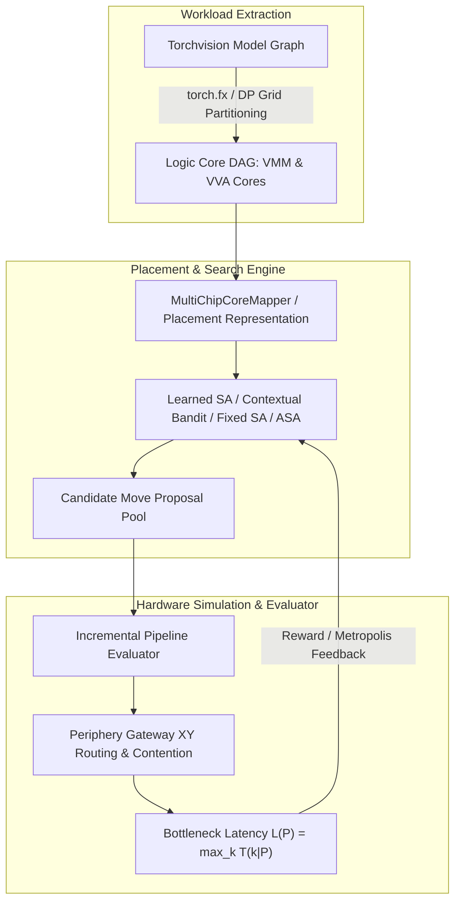

# Codebase Architecture & Contributor Guide

**Repository**: `DNN_MAPPING`
**Active Research Branch**: `minimalist` (streamlined architecture with unified root guide)
**Target Literature**: Wu et al., *Core Placement Optimization for Multi-chip Many-core Neural Network Systems with Reinforcement Learning* (ACM TODAES 2020, [DOI 10.1145/3418498](https://doi.org/10.1145/3418498))

---

## 1. High-Level Architecture

The `DNN_MAPPING` codebase investigates core placement algorithms for multi-chip many-core neural network accelerators. The system models a hierarchical 2D hardware topology:
- Multiple physical chips arranged in a 2D mesh/torus grid ($N_x \times N_y$).
- Each chip contains a 2D mesh of processing cores ($R \times C$).
- Total system cores: $N_{\text{total}} = N_x \cdot N_y \cdot R \cdot C$ (e.g., $4 \times 4 \times 16 \times 16 = 4,096$ physical cores).

Deep neural network (DNN) workloads (AlexNet, VGG16, ResNet50) are partitioned into computational logic cores:
- **VMM (Vector-Matrix-Multiply)** cores perform multiply-accumulate operations on weight tiles.
- **VVA (Vector-Vector-Accumulation)** cores perform spatial reduction across partition channels.

The goal of the placement optimizer is to assign every logic core $i$ to a distinct physical core $P(i)$ such that the **end-to-end bottleneck pipeline latency** $L(P) = \max_k T(k|P)$ across all pipeline stages $k$ is minimized.



---

## 2. Placement Evaluator & Objective Data Flow

### 2.1 The Bottleneck Latency Objective
In a pipelined neural network accelerator, layers or partition blocks execute concurrently across frames. The steady-state throughput is governed by the slowest pipeline stage $k$:
$$L(P) = \max_{k \in \text{stages}} T(k \mid P)$$
where the stage execution time $T(k \mid P)$ comprises arithmetic computation and inter-core communication:
$$T(k \mid P) = \max_{u \in \text{stage } k} \left( T_{\text{comp}}(u) + \max_{v \in \text{succ}(u)} T_{\text{comm}}(P(u), P(v)) \right)$$

### 2.2 Routing & Contention Model
The hardware simulator (`multi_chip_topology.py` and `multi_chip_environment.py`) supports two communication models:
1. **`legacy_distance`**: Manhattan hop distance scaled by on-chip vs. off-chip latency multipliers.
2. **`paper_xy`** (reconstructed paper fidelity):
   - **Intra-chip communication**: Routed using standard dimension-ordered XY routing between cores on the local NoC mesh.
   - **Inter-chip communication**: Routed from the source core to the chip-periphery lower-left gateway router, across the inter-chip NoC grid along X then Y, and from the destination gateway router to the target core.
   - **Shared-link contention**: Link loads are accumulated across concurrent communication streams; serialization time over saturated shared links determines the latency of communicating stages.

### 2.3 Incremental Pipeline Evaluator
Evaluating the complete graph ($N \approx 1,000–3,000$ tasks) takes several milliseconds. When an annealing step relocates or swaps 1–2 tasks, only stages containing the moved tasks or their immediate predecessors/successors change.

[`IncrementalPipelineEvaluator`](../src/run_multi_chip.py) caches unaffected stage latencies and evaluates only the affected stages, providing a **$10\times$ speedup** while guaranteeing exact bitwise mathematical agreement with full evaluation.

---

## 3. Active Source Code Organization

The active multi-chip research codebase is organized cleanly under `src/`:

```
DNN_MAPPING/
├── src/
│   ├── run_multi_chip.py              # Primary placement engine: algorithms, CLI, and models
│   ├── multi_chip_topology.py         # Hardware topology: mesh/torus grid, routing, gateway links
│   ├── multi_chip_environment.py      # RL environment, Kahn DAG pipeline stages, bottleneck latency
│   ├── compute_model.py               # VMM/VVA layer partitioning, DP grid solver, MAC conversion
│   ├── run_multiseed_experiment.py    # Concurrent multi-seed subprocess runner
│   ├── run_paper_experiment.py        # Paper reproduction orchestrator for CONV & FC suites
│   ├── train_oracle_candidate_ranker.py # Supervised candidate ranking trainer
│   ├── validate_device.py             # Hardware verification & component timing profiler
│   ├── main.py                        # Root execution forwarder with legacy pointer
│   │
│   ├── analysis/                      # Post-processing & statistical analysis scripts
│   │   ├── analyze_guided_ablation.py
│   │   ├── analyze_masked_ppo_ablation.py
│   │   ├── analyze_masked_ppo_multichip_gate.py
│   │   ├── analyze_multiseed.py
│   │   ├── analyze_ppo_asa_diagnostic_gate.py
│   │   ├── analyze_ppo_asa_gate.py
│   │   ├── analyze_ppo_asa_holdout.py
│   │   └── diagnose_checkpoint_normalization.py
│   │
│   └── experiments/                   # Special exploratory ablations & prototypes
│       ├── compare_algos.py           # SA vs PPO diagnostic comparator
│       ├── run_compact_state_experiment.py # Compact state representation ablation
│       ├── run_consistent_bn_experiment.py # Consistent BatchNorm mode ablation
│       └── run_multi_chip_fast.py     # Unvalidated fast prototype
│
├── tests/                             # Unit & regression test suite
│   ├── run_all_tests.py               # Unified test runner
│   ├── test_multi_chip.py             # Fast smoke test
│   └── test_reconciliation.py         # 38-case exhaustive hardware regression suite
│
├── scripts/                           # Production Kaggle & bash experiment pipelines
├── legacy/single_chip/                # Archived upstream single-chip GCN PPO framework
└── docs/                              # Research guides, architectural manuals, and historical archive
```

---

## 4. Optimization Algorithms

### 4.1 Classical Baselines
- **Sequential Baseline (`bs`)**: Deterministic baseline placing tasks sequentially in chip-major physical core order.
- **Random Search (`random`)**: Uniform random permutation placement sampling $B$ candidates, returning the minimum latency layout.
- **Fixed Simulated Annealing (`sa`)**: Geometric cooling schedule $T_{k+1} = \alpha T_k$ ($\alpha = 0.99$), calibrating initial temperature $T_0$ to achieve an initial uphill acceptance rate of $80\%$. Perturbs single tasks into unoccupied cores.

### 4.2 Adaptive Simulated Annealing (`asa`)
- Dynamically adjusts temperature based on feedback over windows of 100 evaluations to track a target acceptance rate ($30\%$).
- If acceptance drops too low, temperature increases; if acceptance is too high, cooling accelerates.
- Expands perturbation radius upon stagnation and contracts neighborhood during steady convergence.

### 4.3 Contextual-Bandit-Guided Fixed SA (Active Validated Method)
- Replaces uniform neighbor sampling with a learned candidate ranker inside fixed SA cooling.
- At each step, a candidate pool of $K=16$ legal neighbor moves is generated:
  - 50% anchored on tasks in current bottleneck stages (`--ppo_asa_focus_fraction 0.5`).
  - 50% uniform perturbations across the task graph.
- For each candidate move $m$, a 9-dimensional candidate feature vector is computed:
  1. `in_bottleneck`: Boolean indicator if the moved task belongs to the bottleneck stage.
  2. `is_vva`: Boolean indicator if the task is an accumulation core.
  3. `task_weight`: Normalized arithmetic operations of the moved task.
  4. `stage_task_fraction`: Task operations relative to its stage total.
  5. `predecessor_hops_delta`: Net reduction in communication hops to predecessors.
  6. `successor_hops_delta`: Net reduction in communication hops to successors.
  7. `weighted_hops_delta`: Traffic-weighted communication hop reduction.
  8. `same_chip_delta`: Net change in predecessors/successors placed on the same chip.
  9. `proxy_gain`: Approximate routed communication reduction.
- [`ProposalBanditRegressor`](../src/run_multi_chip.py): A 2-layer MLP ($128$ hidden units, AdamW) predicts the immediate signed objective improvement $\Delta \text{cost} = \text{cost}_{\text{current}} - \text{cost}_{\text{candidate}}$.
- **$\epsilon$-Greedy Action Selection**: Moves are selected greedily with probability $1 - \epsilon$; $\epsilon$ decays linearly over the run to a floor of $0.50$.
- **Metropolis Acceptance**: Fixed SA Metropolis criterion $\min(1, \exp(-\Delta \text{cost} / T))$ evaluates whether the selected move is accepted.

### 4.4 Retained DDPG & Constructive PPO Components
- **Continuous DDPG (`ddpg`)**: Implements the paper's Algorithm 1 with Ornstein-Uhlenbeck noise and continuous-to-discrete Manhattan collision resolution. Supports historical MLP, augmented spatial CNN, and paper Figure 9 CNN architectures (`--agent_arch paper_cnn`).
- **Guided DDPG (`ddpg_guided`)**: Samples legal candidate cores directly, stores executed positions in prioritized replay, and pretrains on ASA demonstrations with twin critics.
- **Constructive Masked PPO (`ppo_masked`)**: Autoregressively places tasks using exact invalid-action masking over unoccupied cores.
- **PPO-Guided ASA (`ppo_asa` with `--ppo_asa_learner ppo`)**: Learns proposal logits using clipped surrogate PPO objectives with decoupled actor and critic networks.

---

## 5. Configuration, CLI & Checkpoints

### 5.1 Common CLI Parameters (`src/run_multi_chip.py`)

| Parameter | Type / Choices | Default | Description |
| :--- | :--- | :--- | :--- |
| `--algo` | `ddpg`, `ddpg_guided`, `ppo_masked`, `ppo_asa`, `sa`, `asa`, `ddpg_asa`, `random`, `bs` | `ddpg` | Optimization algorithm. |
| `--ppo_asa_learner` | `bandit`, `ppo` | `ppo` | Learner for proposal ranking. Set `bandit` for active research. |
| `--ppo_asa_annealing`| `fixed`, `adaptive` | `adaptive` | Annealing schedule beneath proposals. Set `fixed` for active research. |
| `--ppo_asa_candidates`| int | `16` | Size of legal proposal candidate pool. |
| `--ppo_asa_focus_fraction`| float | `0.0` | Fraction of pool anchored on bottleneck tasks (set `0.5` for active). |
| `--model` | `simple`, `alexnet`, `vgg16`, `resnet50` | `simple` | Workload model name. |
| `--workload_region` | `all`, `conv`, `fc` | `all` | Partitioned model region to optimize. |
| `--timing_model` | `proxy`, `full_frame`, `paper_pipeline` | `proxy` | Physical latency evaluation model. |
| `--routing_model` | `legacy_distance`, `paper_xy` | `legacy_distance` | NoC routing model. |
| `--vva_ops_per_cycle`| float | `1.0` | Vector-vector accumulation additions/cycle (use `16` for calibrated). |
| `--device` | `cpu`, `cuda` | `cpu` | Device for PyTorch networks. |
| `--seed` | int | None | Random seed for reproducibility. |
| `--iters` | int | `5000` | Evaluation budget for SA/ASA/Bandit. |

### 5.2 Checkpoints & Results Formats
- **Report JSON (`--report path.json`)**: Contains git provenance, hardware configuration, objective units, baseline $B$, best cost, normalized cost, runtime breakdown, and full placement array ($P(i)$).
- **Diagnostics JSONL (`--diagnostics path.jsonl` or `--asa_diagnostics path.jsonl`)**: Records per-episode / per-window metrics: noise scale, acceptance fraction, objective values, entropy, and loss norms.
- **Model Checkpoints (`--save_checkpoint path.pt`)**: Serializes PyTorch `state_dict`, optimizer state, best placement, and RNG states.

---

## 6. How Kaggle Experiments Are Launched

All production-scale gates are automated via bash scripts in `scripts/`:

```bash
# Active Contextual-Bandit Guided Fixed SA Gates
bash scripts/run_kaggle_rl_fixed_sa_gate.sh bandit-short runs/kaggle-bandit-short
bash scripts/run_kaggle_rl_fixed_sa_gate.sh bandit-extended runs/kaggle-bandit-extended

# Evaluation Sensitivity & Baseline Calibration
bash scripts/run_kaggle_paper_baseline_calibration.sh runs/calibration 1000000 16 1
bash scripts/run_kaggle_evaluator_vva_sensitivity.sh runs/vva-sweep 20000 1
```

Each script:
1. Runs pre-flight reconciliation unit tests (`PYTHONPATH=src python -m unittest src.test_reconciliation`).
2. Validates GPU availability and sets thread bindings (`OMP_NUM_THREADS=1`).
3. Runs paired experimental conditions (trained vs. control) across designated seeds.
4. Generates an `experiment-manifest.json` recording commit hash, parameters, and pass/fail thresholds.
5. Archives logs, diagnostics, and reports into a compressed ZIP file on completion.

---

## 7. Recommended Reading Order for Contributors

1. **[`README.md`](README.md)**: Repository overview, specifications, and quickstart commands from scratch.
2. **[`CODEBASE_GUIDE.md`](CODEBASE_GUIDE.md)**: **(This document)** Complete technical reference, file-by-file explanations, and exhaustive CLI parameters.
3. **[`docs/IMP_README.md`](docs/IMP_README.md)**: Essential contributor rules, branch hygiene, and contextual-bandit execution instructions.
4. **[`docs/PROJECT_STATE.md`](docs/PROJECT_STATE.md)**: Current empirical benchmark numbers, statistical intervals, and hardware reconciliation details.
5. **[`docs/PROJECT_JOURNEY.md`](docs/PROJECT_JOURNEY.md)**: Complete chronological research narrative from paper reproduction through DDPG failure analysis, PPO, and contextual-bandit SA.
6. **[`docs/NEXT_STEPS.md`](docs/NEXT_STEPS.md)**: The active 66-item experimental backlog and immediate pending tasks.
7. **[`docs/RESEARCH_FINDINGS.md`](docs/RESEARCH_FINDINGS.md)**: Theoretical grounding, DDPG failure analysis, and VVA throughput sensitivity review.

---

## 8. Historical-Only Components

The following components are preserved for auditability and historical reference, but are **not** part of the active multi-chip research pipeline:
- **`legacy/single_chip/`**: The upstream single-chip GCN PPO netlist framework.
- **`src/experiments/run_multi_chip_fast.py`**: An early unvalidated fast DDPG prototype.
- **`src/experiments/compare_algos.py`**: An early standalone script comparing SA and PPO on random graphs. Note: preserved in its exact original state; it is historically stale and cannot run as-is because `run_ppo` in `run_multi_chip.py` was long ago refactored to `run_masked_ppo`, and its random task graph is symmetric (violating Kahn DAG acyclicity requirements for pipeline scheduling).
- **`src/experiments/run_consistent_bn_experiment.py`** & **`run_compact_state_experiment.py`**: Exploratory normalization/state ablations.
